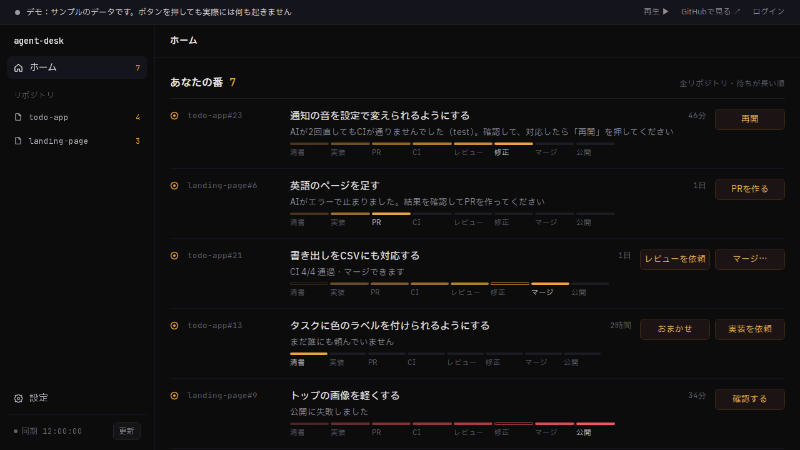
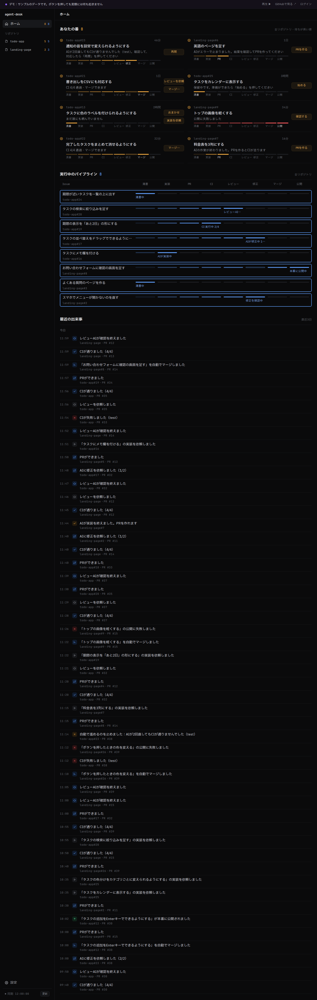
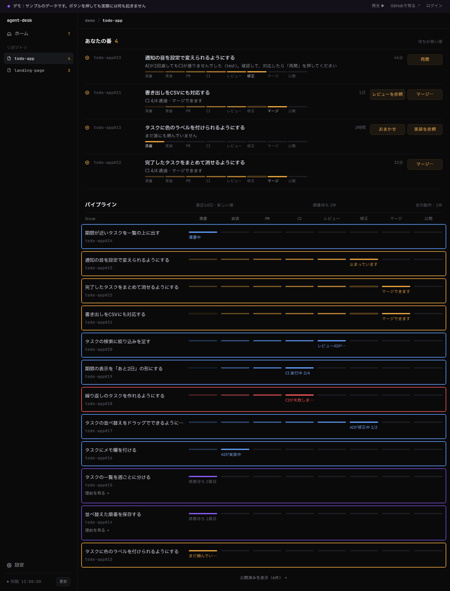
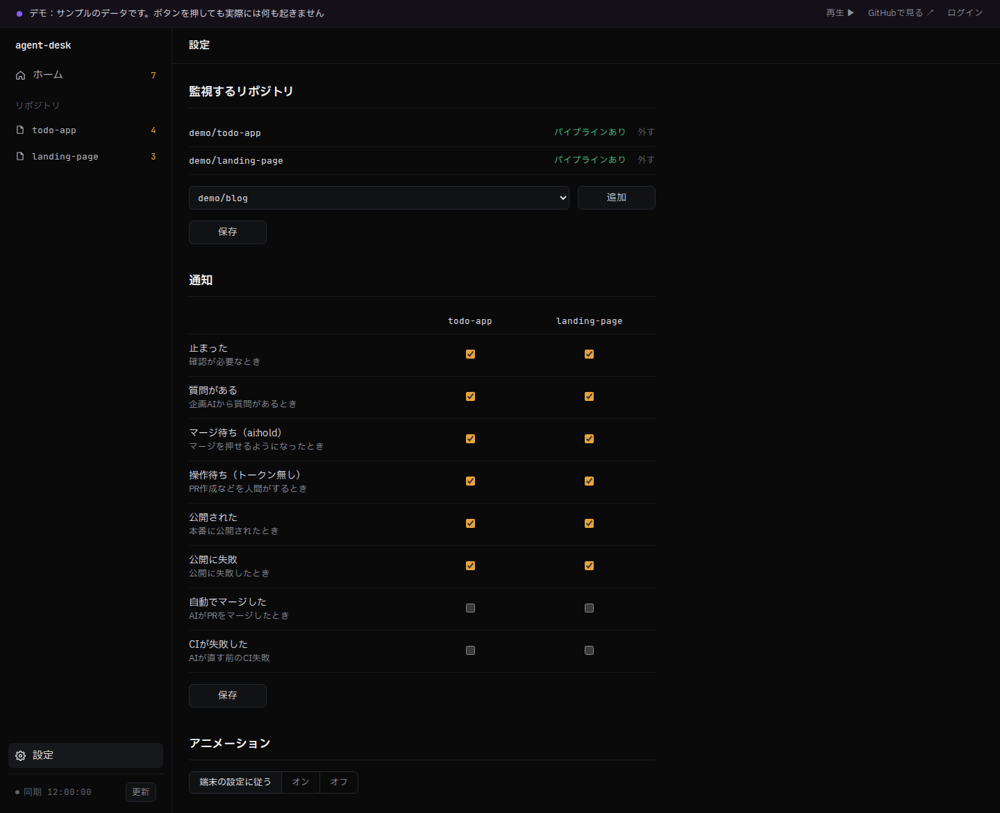
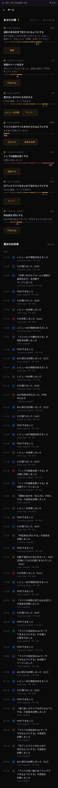

# agent-desk

AIに開発を任せるときの、**進行状況と「人間の判断待ち」を1画面で見る**ダッシュボード。

**[デモを見る](https://agent-desk-ip1u.vercel.app/demo)**（ログイン不要。サンプルのデータで、右上の「再生 ▶」を押すと上のGIFと同じ動きが見られます）

## 何ができるか

### 上：流れ

Issueが光の粒になって、清書 → 実装 → PR → CI → レビュー → 修正 → マージ → 公開 の列を左から右へ流れます。色で、あなたの番・AIの番・待機・失敗・公開済みが分かります。

### 下：あなたの番と、出来事

全リポジトリのうち、AIが止まって人間の判断が要るものだけを、件数の巨大な数字と一緒に、待っている時間が長い順に並べます。その場で「再開」「マージ」などを押せます。出来事はIssueごとにまとめて、足あとのように並びます。

### リポジトリのページ

同じ画面を、1つのリポジトリだけに絞って見られます。

### 設定：監視するリポジトリ・通知・アニメーション

### スマホでも

## どうやって作ったか

このアプリ自身も、[ai-dev-template](https://github.com/Gaku1205/ai-dev-template) の全自動パイプライン（メモを書く → AIが清書・実装・レビュー・修正・マージ → 公開）で、メモからAIが作りました。人間が書いたのは仕様書（[docs/spec.md](docs/spec.md)）とデザイン仕様（[docs/design.md](docs/design.md)）と、Issueのメモだけです。

その記録が、このリポジトリの [Issue](../../issues?q=is%3Aissue) と [Pull request](../../pulls?q=is%3Apr) の履歴です。

## 技術

Next.js（App Router）・TypeScript・Auth.js（GitHubログイン）・GitHub REST API・Vitest・Playwright・Vercel

Vercelは、`.github/` と `docs/pipeline.md` だけの変更では公開を飛ばします。

## セットアップ：同期の読み取りをパイプラインのAppの鍵で行う（任意）

ふつうは、ログインした人（オーナー）のトークンで同期のデータを読みます。この回数制限（1時間5,000回）は、ほかのツール（`gh` など）と共有です。パイプラインのGitHub App（`gaku-ai-pipeline`）の鍵で読めば、別の回数（インストールごと）を使えます。

Vercel の agent-desk の環境変数に、パイプラインのSecretと同じ名前・同じ値で入れて、公開し直してください。

| 名前 | 値 |
| --- | --- |
| `PIPELINE_APP_ID` | AppのID |
| `PIPELINE_APP_PRIVATE_KEY` | 秘密鍵（`.pem` の中身。改行が `\n` の文字で入っていても読めます） |

- 入れなくても今までどおり動きます。Appが入っていないリポジトリ、鍵が取れないときも、ログインした人のトークンで読みます
- Appの鍵で読むのは、ログインした人のトークンで読めると確かめたリポジトリだけです。ボタンの操作は、いつもログインした人のトークンで行います
- 鍵はサーバーだけで使い、画面にもログにも出しません（詳しくは [docs/spec.md](docs/spec.md) の「読み取りの鍵」）

## READMEの画像の撮り直し

見た目を変えたときは、`npm run readme:shots` で `assets/readme/` の画像とGIFを撮り直します（初回は `npx playwright install chromium` が要ります）。
